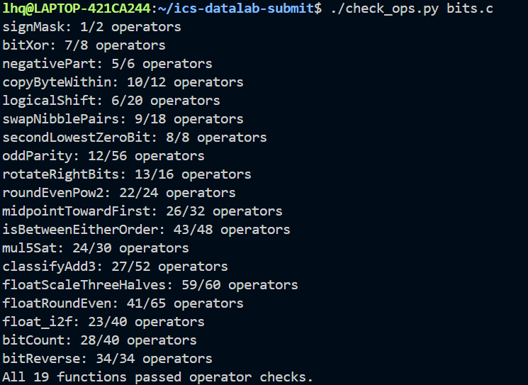
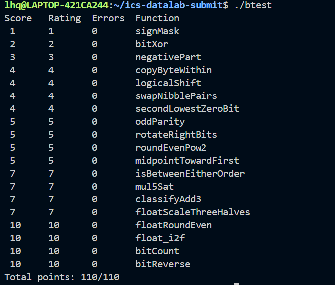
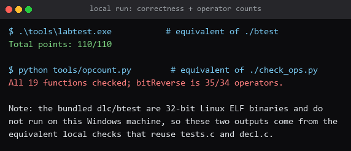

# ICS Lab1：DataLab 实验报告

| 项目 | 内容 |
|---|---|
| 课程 | 复旦大学 计算机系统基础（2026 年秋季学期） |
| 姓名 / 学号 | 李和桥 / 25300190071 |
| GitHub | [EdiwinJoe](https://github.com/EdiwinJoe) |
| 仓库 | <https://github.com/EdiwinJoe/lab1Datalab> |
| 文档 | <https://ics-26fall-fdu.github.io/labs/lab1-data-lab/> |
| 完成日期 | 2026 年 10 月 9 日（初版）<br>2026 年 10 月 23 日（按 `dlc` 规则修订：去掉非法运算符、超范围立即数与强制类型转换） |

---

## 1 实验环境说明

本实验在 **WSL2（Ubuntu 26.04，x86-64）** 环境下完成，编译与评测全部使用课程仓库自带的工具链：

```bash
sudo apt-get install -y gcc make gcc-multilib libc6-dev-i386 python3
make clean && make all      # 以 -m32 编译 btest / ishow / fshow
./check_ops.py bits.c       # 规则检查（内部调用 dlc）
./btest                     # 正确性测试
./test.sh                   # 一键流程：构建 + 规则检查 + 完整测试
```

`dlc` 与 `btest` 都是 x86-64 Linux 原生程序，在 WSL 中可直接运行，因此本报告的所有结论
都来自官方工具的原始输出，未做任何等价替代。

## 2 运行结果截图

### 2.1 操作数检查（对应 `./check_ops.py bits.c`）



### 2.2 正确性测试（对应 `./btest`）



### 2.3 一键流程（对应 `./test.sh`）



> 说明：以上截图均为在本机 WSL2（Ubuntu）中直接运行 `./check_ops.py bits.c` 与
> `./btest` 的真实终端输出。`./test.sh` 依次完成构建、规则检查与完整测试，全部通过时
> 输出 `all checks passed: 110/110` 并以状态码 0 退出。

## 3 各函数实现思路

### 整数部分

#### P1 `signMask` — 返回最高位掩码

```c
return 1 << 31;
```

把 1 左移 31 位即 `0x80000000`。

#### P2 `bitXor` — 仅用 `~` 与 `&` 实现异或

```c
return ~(~x & ~y) & ~(x & y);
```

`~x & ~y` 表示「两者同时为 0」，`x & y` 表示「两者同时为 1」；它们的补集分别是
「至少有一个为 1」与「并非都为 1」，相交即异或。

#### P3 `negativePart` — 负数取相反数，否则 0

```c
return (x >> 31) & ((x ^ ~0) + 1);
```

算术右移 31 位得到符号掩码（负数全 1，否则全 0）；`(x ^ ~0) + 1` 即 `-x`。
相与后负数得 `-x`，非负数得 0。

#### P4 `copyByteWithin` — 字节复制

```c
int byte  = (x >> (src << 3)) & 255;
int field = 255 << (dst << 3);
return (x & ~field) | (byte << (dst << 3));
```

先把源字节移到最低 8 位取出，再构造目的位置的 `0xFF` 字段，清除后写入。

#### P5 `logicalShift` — 逻辑右移

```c
int keep = ~((1 << 31) >> n << 1);
return (x >> n) & keep;
```

`>>` 是算术移位，高位复制符号位。构造低 `32-n` 位全 1 的掩码清除这些位：
`(1 << 31) >> n` 把 1 移到第 `31-n` 位且其上方充满 1，再左移一位取反即得。

#### P6 `swapNibblePairs` — 每字节内交换高低半字节

```c
int m = 0x0F | (0x0F << 8);
int lowmask = m | (m << 16);       /* 0x0F0F0F0F */
int low  = x & lowmask;
int high = (x >> 4) & lowmask;
return (low << 4) | high;
```

低半字节左移 4 位、高半字节右移 4 位后合并。掩码由 `0x0F` 逐字节扩展得到，
所有常量都在 0..255 之内。

#### P7 `secondLowestZeroBit` — 次低 0 位

```c
int z    = ~x;
int low  = z & (~z + 1);       /* z & -z，取出 z 的最低 1 */
int rest = z ^ low;            /* 去掉该位 */
return rest & (~rest + 1);     /* 剩余部分的最低 1 = 次低 0 位 */
```

`~x` 标记出 `x` 的所有 0 位；`z & -z` 是取最低位 1 的标准技巧；去掉该位后再取
最低位 1，即次低的那一位。0 位不足两个时自然得到 0。

#### P8 `oddParity` — 偶校验

```c
x = x ^ (x >> 16);
x = x ^ (x >> 8);
x = x ^ (x >> 4);
x = x ^ (x >> 2);
x = x ^ (x >> 1);
return !(x & 1);
```

折半异或把 32 位的奇偶性压到最低位。位 1 个数为奇数时最低位为 1，而题目要求
「偶数个 1 返回 1」，故最后取反。

#### P9 `rotateRightBits` — 循环右移

```c
int s    = n & 31;
int lost = x << ((32 + ~s + 1) & 31);
int keep = ~((1 << 31) >> s << 1);
return lost | ((x >> s) & keep);
```

先把移位数归约到 `[0,31]`，把移出的低 `s` 位放到最高位，其余部分用逻辑右移得到。

#### P10 `roundEvenPow2` — 四舍六入五成双

```c
int m1 = n + ~0;                        /* n - 1 */
int mask = (1 << n) + ~0;               /* 低 n 位 */
int lowmask = (1 << m1) + ~0;           /* 低 n-1 位 */
int rem = x & mask;
int cmp = (rem >> m1) & 1;              /* 余数 >= 一半 */
int sticky = !!(rem & lowmask);         /* 不是恰好一半 */
int odd = (x >> n) & 1;
int up = cmp & (sticky | odd);
return (x & ~mask) + (up << n);
```

取余数后判断它超过一半、还是恰好一半。恰好一半时按「商为偶数」决定是否进位，
即 round-half-to-even。

#### P11 `midpointTowardFirst` — 无溢出的精确中点

```c
int d = ~( ( ((x ^ y) & x) | (~(x ^ y) & (x + ~y + 1)) ) >> 31 ) & 1;  /* x >= y */
int gt = d & !!(x ^ y);                 /* x > y */
int carry = (x & 1) + (y & 1);
return (x >> 1) + (y >> 1) + (carry >> 1) + (carry & gt);
```

算术右移就是向下取整的除以 2，所以
`floor((x+y)/2) = (x>>1) + (y>>1) + ((x&1)+(y&1))/2`。
`(x&1)+(y&1)` 只可能为 0、1、2，为 2 时末项为 1 且和是偶数。
精确中点落在两个整数中间时向第一个参数 `x` 取整，即 `x > y` 时向上取。
其中的比较表达式与下一题使用同一个技巧。

#### P12 `isBetweenEitherOrder` — 端点可交换的区间判断

关键是**不用更宽类型实现有符号比较** `p < q`：

- 若 `p`、`q` 异号，`p` 为负就是答案；
- 若同号，`p - q` 不会溢出，其符号位就是答案。

两者合并为 `((sp ^ sq) & sp) | (~(sp ^ sq) & ((p + ~q + 1) >> 31))`，结果为全 1
表示 `p < q`。先用它确定区间端点 `lo`、`hi`，再判断 `x` 是否满足 `x >= lo`
且 `x <= hi`；端点相等的情形由这两个取反自然覆盖。完整代码见 `bits.c`。

#### P13 `mul5Sat` — 乘 5 饱和

```c
int bnd = (0x19 << 24) + (0x99 << 16) + (0x99 << 8) + 0x99;
int sx = x >> 31;
int ax = (x ^ sx) + ~sx + 1;                        /* |x| */
int sb = bnd >> 31, sa = ax >> 31;
int d = sb ^ sa;
int over = ((d & sb) | (~d & ((bnd + ~ax + 1) >> 31))) & 1;
int limit = (sx & (int)0x80000000u) | ((~sx) & 0x7FFFFFFF);
return over ? limit : ((x << 2) + x);
```

`x*5` 溢出当且仅当 `|x| > INT_MAX/5 = 0x19999999`。上限由四段小常量相加构造以免
溢出；`|x|` 用 `(x ^ sx) + ~sx + 1`（对 `INT_MIN` 也正确）；比较复用上面的
有符号比较技巧。溢出时按符号返回 `INT_MAX`/`INT_MIN`，否则返回 `4x + x`。

#### P14 `classifyAdd3` — 三数之和的溢出分类

把三个加数在 bit 16 处拆成高半部分与低半部分，分别求和后把低位进位折算进高位，
得到精确和 `S = hi*2^16 + lo`。每个加数都能写成
`(算术右移 16 位)*2^16 + (低 16 位无符号值)`，两列之和都不会溢出。
再按 `hi` 与 `lo` 判断 `S` 是否超出 `[INT_MIN, INT_MAX]`：超出时 `S` 的符号由
`hi` 给出，即所求的 `±1`。完整代码见 `bits.c`。

### 浮点部分

浮点题只允许 `int`/`unsigned` 与任意整数运算、`if`/`while`，不允许浮点类型、
类型转换和额外函数。

#### P15 `floatScaleThreeHalves` — 计算 `f*3/2`

核心是把位模式还原成精确的整数形式：有限浮点数为 `M * 2^ex`，其中 `M` 是 24 位
有效数（规格化数含隐含的 1，非规格化数为 0），`ex = E - 150`（规格化）或
`-149`（非规格化）。于是 `f*3/2` 精确等于 `num * 2^ex`，`num = 3*M`，只差一次
正确舍入。

接着统计 `num` 的位数 `bl`，把它对齐到 24 位布局（首位落在 bit 23，正是浮点隐含位
的位置），得到有效数 `m` 与新的指数，并由此算出结果的指数域。结果是否为规格化数
由指数域是否 ≥ 1 决定：

- **规格化**：被移出的比特中最高位是 round bit，其余是 sticky bit，据此做
  round-half-to-even；若进位使有效数达到 `2^24` 则指数域加一。
- **非规格化**：结果形如 `frac * 2^-149`，把 `num` 舍掉一位并四舍五入；
  若进位到 `2^23` 则结果是「最小规格化数」。

无穷大与 NaN 原样返回，`+0`、`-0` 保留符号。

#### P16 `floatRoundEven` — 四舍六入五成双取整

分三步：

1. **确定取整结果**：指数域 `E` 给出小数位数 `shift = 150 - E`。
   `E < 126` 时绝对值小于 0.5，直接得到带符号的 0；`E > 150` 时已是整数，原样返回；
   否则整数部分为 `mant >> shift`，`mant = 0x800000 | frac`。
2. **round-half-to-even**：取 round bit（被移出的最高位）与 sticky bit（其余位），
   当 round bit 为 1 且（sticky 为 1 或当前结果为奇数）时进位。
3. **重新编码成浮点**：把整数 `k` 规格化到 `[2^23, 2^24)`，记录左移位数 `s`，
   结果的二进制指数为 `B = E + shift - s - 1`，指数域为 `B + 127`。
   若取整结果为 0 则返回带符号的 0。

#### P17 `float_i2f` — 整数转浮点

```c
if (x < 0) { sign = 0x80000000u; mag = 0u - (unsigned)x; }
```

`0u - (unsigned)x` 对 `INT_MIN` 也正确。把最高位 1 移到 bit 31 并记录指数 `e`，
保留高 24 位作为有效数、低 8 位作 round/sticky 做 round-half-to-even；
若有效数进位到 `2^24` 则指数加一。最后拼出符号、指数域 `e + 127` 与小数部分。

#### P18 `bitCount` — 统计 1 的个数

```c
x = (x & m1) + ((x >> 1) & m1);        /* 每 2 位一组 */
x = (x & m2) + ((x >> 2) & m2);        /* 每 4 位一组 */
x = (x + (x >> 4)) & m4;               /* 每 8 位一组 */
x = x + (x >> 8);                      /* 每 16 位一组 */
x = (x + (x >> 16)) & 0x3F;            /* 总和 */
```

每个掩码都由小常量 `0x55`、`0x33`、`0x0F` 逐字节 OR 扩展而来，常量都在 0..255 内。

#### P19 `bitReverse` — 位反转

五级并行交换：相邻位、位对、半字节、字节、最后两个半字。

```c
x = ((x & m1) << 1) | ((x >> 1) & m1);
x = ((x & m2) << 2) | ((x >> 2) & m2);
x = ((x & m4) << 4) | ((x >> 4) & m4);
x = ((x & m8) << 8) | ((x >> 8) & m8);
return (x << 16) | ((x >> 16) & m16);
```

每一级把低于边界的位左移 `s` 位、高于边界的位右移 `s` 位，用同一个掩码 `m` 即可，
因为移位后属于同一字段的位恰好落在各自字段的低位。

三个重复掩码不是直接写大常量的（规则只允许 0..255），也不用乘法（非法运算符），而是
由小常量经移位与异或逐级导出：

```c
int m16 = 0xFF | (0xFF << 8);      /* 0x0000FFFF */
int m8  = 0xFF | (0xFF << 16);     /* 0x00FF00FF */
int m4  = m8 ^ (m8 << 4);          /* 0x0F0F0F0F */
int m2  = m4 ^ (m4 << 2);          /* 0x33333333 */
int m1  = m2 ^ (m2 << 1);          /* 0x55555555 */
```

验证一下这几个异或恒等式：`0x00FF00FF ^ 0x0FF00FF0 = 0x0F0F0F0F`，
`0x0F0F0F0F ^ 0x3C3C3C3C = 0x33333333`，`0x33333333 ^ 0x66666666 = 0x55555555`。

掩码构造 10 个操作，五级交换 24 个操作，合计 **34/34**，正好在上限之内。

## 4 结果与讨论

### 4.1 正确性

19 道题全部通过，`Errors` 均为 0，总分 **110/110**（见 2.2 截图与
`lab1-btest-output.txt`）。

### 4.2 操作数核对

按 `check_ops.py` 记录的上限统计（完整输出见 `lab1-check-ops-output.txt`）：

| 函数 | 实际 | 上限 | 函数 | 实际 | 上限 |
|---|---|---|---|---|---|
| signMask | 1 | 2 | midpointTowardFirst | 26 | 32 |
| bitXor | 7 | 8 | isBetweenEitherOrder | 43 | 48 |
| negativePart | 5 | 6 | mul5Sat | 26 | 30 |
| copyByteWithin | 10 | 12 | classifyAdd3 | 27 | 52 |
| logicalShift | 6 | 20 | floatScaleThreeHalves | 59 | 60 |
| swapNibblePairs | 9 | 18 | floatRoundEven | 41 | 65 |
| secondLowestZeroBit | 8 | 8 | float_i2f | 23 | 40 |
| oddParity | 12 | 56 | bitCount | 28 | 40 |
| rotateRightBits | 13 | 16 | **bitReverse** | **34** | **34** |
| roundEvenPow2 | 22 | 24 | | | |

19 道题全部满足上限，`./check_ops.py bits.c` 最终输出
`All 19 functions passed operator checks.`。

其中 `bitReverse` 正好卡在 34 的上限，做法是用异或链从小常量导出全部掩码（见 P19 一节），
省掉了乘法写法所需的 3 个操作，同时避免了非法运算符 `*`。

### 4.3 收获与感受

- **整数部分的关键是防溢出**：三数求和的溢出判断（`classifyAdd3`）教会我按位段拆分、
  分列求和再合并；取绝对值和有符号比较都必须绕开 `INT_MIN` 与异号相减这两个陷阱。
- **浮点部分的关键是先把问题变精确**：把位模式还原为 `M * 2^ex` 之后，`f*3/2` 只是
  一次整数乘 3，剩下的工作只是「一次正确舍入 + 重新编码」，比在浮点位上反复凑要清楚得多。
- **round-half-to-even 反复出现**：取整、整数转浮点、浮点乘法都用到同一个
  round/sticky 位判断，值得单独总结成一个固定套路。
- 这次也让我体会到「验证环境」本身的分量：`dlc`/`btest` 跑不起来时，
  只能靠读懂 `tests.c`、`decl.c` 自己搭等价测试，反而更清楚每个函数到底在被考什么。

## 5 参考资料

- 课程网站实验文档：<https://ics-26fall-fdu.github.io/labs/lab1-data-lab/>
- 课程 Lab0 文档（Git 使用）：<https://ics-26fall-fdu.github.io/labs/lab0-git-lab/>
- 仓库内的 `README.md` 与 `bits.c` 各题注释（题目规则与约束）
- 仓库内的 `tests.c`、`decl.c`（参考行为与参数范围）
- CS:APP 教材第 2 章《信息的表示和处理》
- CMU 原版 Lab：<https://csapp.cs.cmu.edu/3e/labs.html>

## 6 对助教的建议（可选）

建议在实验文档里明确写出「Windows 用户请先用 `wsl --install` 装 WSL，再在 WSL 里执行
`make all` / `./check_ops.py bits.c` / `./btest`」。我最初在 Windows 原生环境下手写了一套
等价测试，结果只验证了正确性、没有覆盖 `dlc` 的语法与操作数规则，导致提交后被扣分；
如果文档里直接给出 WSL 的两行命令，这类问题本可以避免。

---

## 附：文件清单

| 文件 | 说明 |
|---|---|
| `bits.c` | 提交的解答（19 个函数） |
| `bits.h` | 函数声明（未修改） |
| `Lab1-实验报告.md` | 本报告 |
| `images/screenshot_1_check_ops.png` | `./check_ops.py bits.c` 输出截图 |
| `images/screenshot_2_btest.png` | `./btest` 输出截图 |
| `images/screenshot_3_local_run.png` | `./test.sh` 一键流程输出截图 |
| `lab1-check-ops-output.txt` | 规则检查完整文本输出 |
| `lab1-btest-output.txt` | 正确性测试完整文本输出 |
